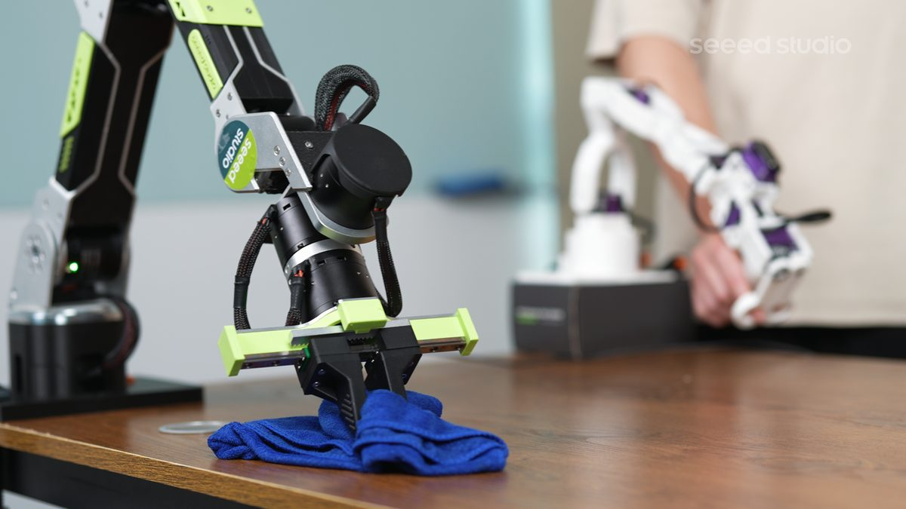
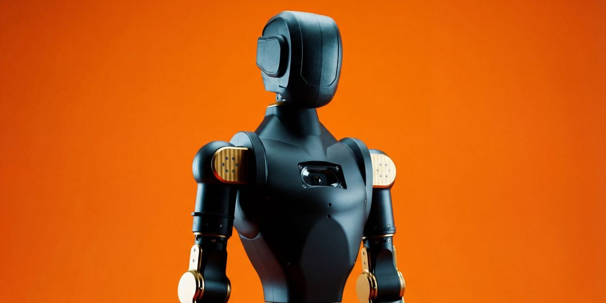

<p align="center">
  
</p>

<h1 align="center">field-notes</h1>

<p align="center">
  <em>Urban-sketch ink and watercolour for Claude Code.<br>
  Hand it a photo, a machine or an icon, and it draws it back as a page from a sketchbook.</em>
</p>

---

A skill for drawing icons and illustrations in the **Field Notes** style: urban-sketch line and
wash, with loose ink and watercolour for big forms, careful hand-drawn precision for small
mechanical parts, and line weight that follows light from the upper left. Machines and icons come
in two views, a 2D front elevation and a 3D oblique; busy photo scenes are painted flat first and
then traced into ink and wash.

## From photo to field notes

Each drawing below is the skill's own output from the photo beside it, rendered by inkwash as an
SVG.

<table>
  <tr>
    <th width="50%">Photo</th>
    <th width="50%">Field Notes</th>
  </tr>
  <tr>
    <td></td>
    <td></td>
  </tr>
  <tr>
    <td colspan="2" align="center"><sub><b>A city skyline</b>, a busy scene: painted flat, traced, then the towers, sails and flag redrawn by hand.</sub></td>
  </tr>
  <tr>
    <td></td>
    <td></td>
  </tr>
  <tr>
    <td colspan="2" align="center"><sub><b>A robot arm at work</b>: the gripper drawn precisely, the background left loose, the cropped arm completed from reference photos.</sub></td>
  </tr>
  <tr>
    <td></td>
    <td></td>
  </tr>
  <tr>
    <td colspan="2" align="center"><sub><b>A humanoid robot</b>, hand-drawn part by part from the photo with the kit.</sub></td>
  </tr>
</table>

## What it does

The agent picks it up when it draws in this style or converts something to it, for example "draw
this machine in the Field Notes style", "turn this photo into line and wash" or "make the 3D
version". The skill brings the rules that came out of review: what to take from a reference photo,
the real thing and the original icon, where to be loose and where to be precise, how 2D gets depth
without receding faces, how to keep parts in front of the ink behind them, and a part-by-part
check before handing a drawing over.

It also ships **inkwash**, the toolkit that draws the style. A drawing is a small Python body file
that uses the marks in `kit.py`. `inkwash.py build` turns it into a sketch, renders that to an SVG
with pressure-sensitive strokes ([perfect-freehand](https://github.com/steveruizok/perfect-freehand))
and watercolour SVG filters, and saves a PNG preview through Playwright's Chromium. It also renders
before-vs-after sheets and zoomed crops for checking parts. The SVGs are self-contained, so they
can go straight into a page, a design tool or Excalidraw, or a README like this one.

## Prerequisites

- Python 3.10 or newer.
- Node.js 20 or newer with npm, and network access the first time.
  `python3 <skill-dir>/scripts/inkwash.py setup` installs perfect-freehand and Playwright with its
  Chromium into `~/.cache/field-notes/node`, or `$FIELD_NOTES_NODE_DIR`; a build does it by itself
  when they are missing.
- For portraits and busy photo scenes only, [uv](https://docs.astral.sh/uv/): `paint_trace.py`
  runs with OpenCV and numpy that `uv run --with` brings in.

## Install

```sh
claude plugin marketplace add AH-Merii/claude-plugins && claude plugin install field-notes@ah-merii
```

The skill appears as `field-notes:field-notes`. Claude loads it when a task matches; you can also
call it directly with `/field-notes:field-notes`.

## Building an example

`skills/field-notes/examples/` holds the set the agent samples from: approved before-and-after
pairs, the body files for a winding machine and a press, and `traced_photo.py`, which draws a
portrait or busy photo scene from the output of `scripts/paint_trace.py` (the skill's "Complex
images" section). To build one:

```sh
python3 plugins/field-notes/skills/field-notes/scripts/inkwash.py build \
  plugins/field-notes/skills/field-notes/examples/winding_machine.py --out /tmp/field-notes
```

## Tests

```sh
python3 -m unittest discover -s plugins/field-notes/tests
```

They need only Python: Node and npm are fakes that log their calls. They check that every example
builds the same sketch for a seed, that the kit marks what the renderer layers, that line weight
follows the light, and that the Node steps run with the cached packages. The real renderer is
checked by building an example as above.
